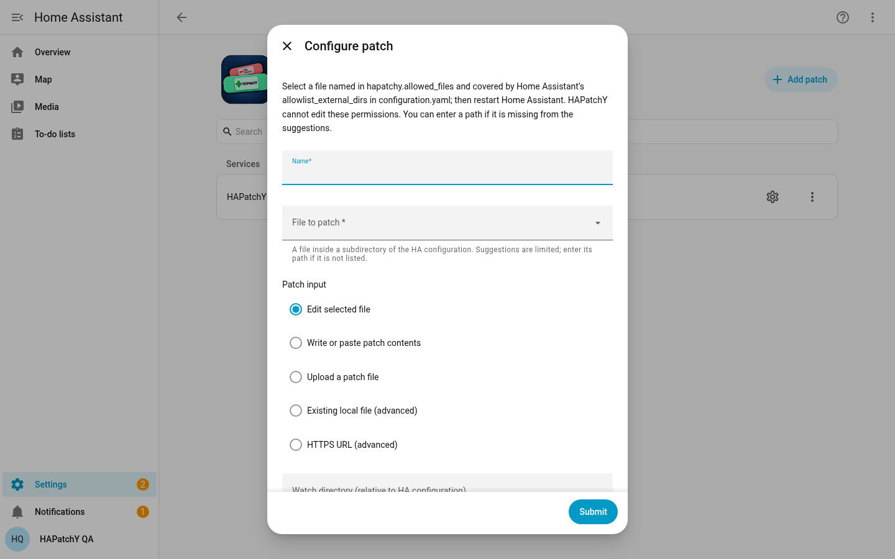

# Authorize exact files for HAPatchY

[Documentation home](index.md) · [← Installation](installation.md) · [First patch →](first-patch.md)

HAPatchY starts with no authorized targets. The Home Assistant operator must
allow the **containing directory** in HA's `allowlist_external_dirs` and name
**each exact target file** in HAPatchY's `allowed_files`. The Add patch form and
API cannot grant permission. This distinction matters: allowing a directory in
HA does not authorize all of its files for HAPatchY.

For the [first-patch tutorial](first-patch.md), create
`hapatchy_ui_demo/settings.txt` and add these entries to your existing
`configuration.yaml`:

```yaml
homeassistant:
  allowlist_external_dirs:
    - /config/hapatchy_ui_demo

hapatchy:
  allowed_files:
    - hapatchy_ui_demo/settings.txt
```

Keep other `homeassistant:` settings in the **same** mapping; do not create a
second key. `/config` is HA's common internal configuration path; use the path
HA actually sees if different. HAPatchY's file path is relative to the folder
containing `configuration.yaml`, with no leading slash. Add one list item per
file. The example authorizes only `settings.txt`, not another file in the same
folder. Glob patterns, directory names, absolute paths, `..`, links, protected
paths and files directly in the configuration root are not valid file grants.
An entry in `allowed_files` can name a file that is temporarily missing; it
never authorizes a different file that later appears beside it.

Save the YAML and **restart Home Assistant**. HAPatchY freezes the grants at
startup. Changing a grant-bearing YAML source or its include structure during
a run blocks patch operations until the next HA restart. Reloading only the
integration does not approve new grants. Malformed YAML can prevent HA itself
from starting, so keep a backup of your configuration before editing it. The
Add patch picker suggests existing permitted files; manually entered paths and
direct API calls receive the same backend checks. HA's live path-permission
check also applies.



This Add patch form was captured in Chromium on disposable HA 2026.10.1 using
this repository revision. The native API smoke test also verified that an
unlisted sibling in the same HA-allowed folder is refused without changing its
bytes; the screenshot alone does not prove that backend check.

## Existing installations

Replace each old `hapatchy.allowed_directories` entry with exact target paths in
`hapatchy.allowed_files`, then restart HA. Existing patch definitions are kept,
but a directory entry alone no longer authorizes Apply, Revert, Refresh source,
startup checks or editor reads. A denied patch reports a Repair explaining the
missing file grant; HAPatchY does not infer or approve grants from saved patch
definitions. You may leave an old `allowed_directories` list temporarily while
migrating: it is validated but grants no access. Remove it when the file list is
complete. Keep HA's `allowlist_external_dirs` as directory entries.

For example, an existing rule targeting `custom_components/huawei_solar/const.py`
needs that **exact path** under `hapatchy.allowed_files`; an HA grant for the
containing directory remains separate. A rule targeting a second file needs a
second file entry. A watch pattern filters events for one configured target and
does not widen the file grant.

The native editor reads the full text of an authorized file for an HA
administrator using the API. The same authorization permits a patch to change
that file. Grant only specific files whose contents may be read and changed
through this API. A directory or file grant does not review patch contents or
sandbox Python that HA may later execute. An agent that can edit
`configuration.yaml` or use another unrestricted file-writing API is outside
this API-only boundary.

The administrator **View patch** action can return the current diff on demand
after checking the target authorization; the diff is not included in entity
states or diagnostics.

If an integration update temporarily removes the target or its containing
folder, HAPatchY does not recreate it. The watcher retries an unavailable
folder every 60 seconds and checks the patch when it returns. A Repair remains
until a completed check succeeds. Reapplication still requires a unique exact
match; if upstream changed incompatibly, the patch reports a conflict and
leaves the target unchanged. A changed Python file needs an HA restart before
the running integration uses its new code.
