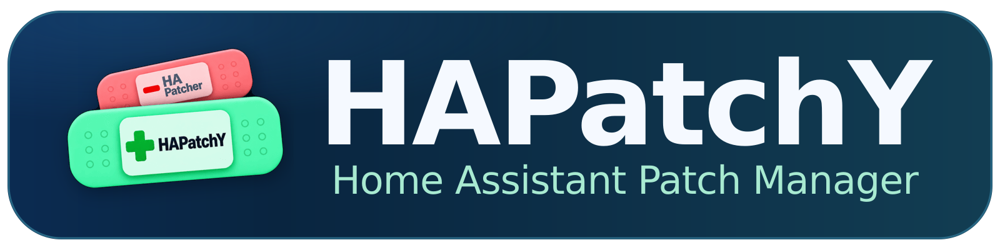

# HAPatchY documentation

HAPatchY keeps a deliberate change to one authorized text or code file in an
eligible subfolder of Home Assistant's configuration directory, for example
`custom_components/huawei_solar/const.py`. It applies a patch only when the surrounding
text still matches unambiguously. Start with an unused text file before changing
an integration. Files directly in the configuration root and HA's YAML
configuration sources remain protected even when a grant names them.

## What do you want to do?

- **[Install HAPatchY](installation.md):** Choose HACS or manual installation,
  then add the integration.
- **[Make your first patch](first-patch.md):** Edit an unused file and check
  Apply, backup and Revert.
- **[Authorize a file](directory-permissions.md):** Name the exact target in
  HAPatchY and its containing folder in HA, then restart HA.
- **[Configure a patch or use an action](reference.md):** Look up exact fields,
  states, limits and administrator actions.
- **[Fix a problem or remove a patch](troubleshooting.md):** Diagnose status
  and Repairs, then recover safely.
- **[Change a saved diff](reference.md#change-a-saved-managed-patch):** Revert,
  edit and update its inherited hash before applying the replacement.
- **[Restore a missing managed patch](troubleshooting.md#restore-a-missing-managed-patch):**
  Recover the exact source before attempting Revert.
- **[Revoke file access](directory-permissions.md#revoke-a-files-access):**
  Remove one grant while retaining other authorized targets.

HAPatchY changes files in your HA configuration. Keep an independent backup
and authorize only files whose contents may be read and changed through
the HA administrator API. Read the [product limits](https://github.com/Ryther/hapatchy#before-using-it)
and [file-permission rules](directory-permissions.md) before patching a real file.

## Contribute or understand the design

- [Architecture](architecture.md) explains the patch engine, filesystem safety
  and Home Assistant lifecycle.
- [Contribution rules](https://github.com/Ryther/hapatchy/blob/main/CONTRIBUTING.md) cover the Dev Container, tests and
  review expectations.
- [Releasing](releasing.md) describes version proposals and publication.

For a quick overview of the integration, return to the [repository README](https://github.com/Ryther/hapatchy#readme).
