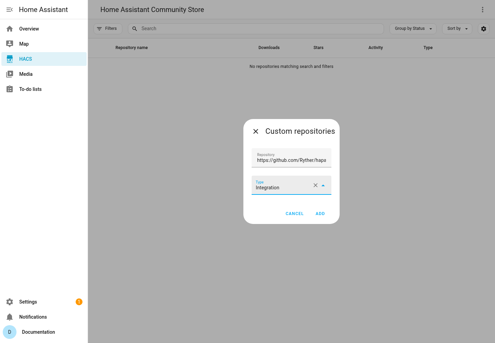
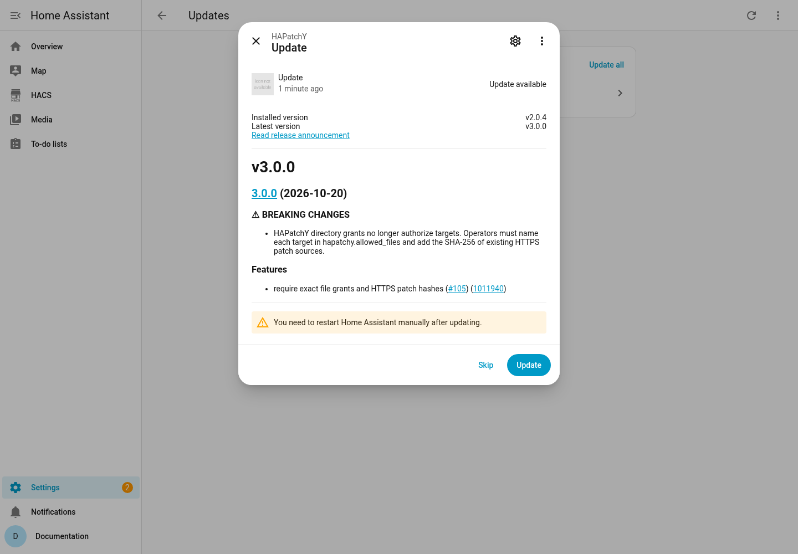

# Install HAPatchY

[← Documentation home](index.md) · [Next: your first patch →](first-patch.md)

## What you need

- Home Assistant **2026.7.4 or newer** and an administrator account. This HA
  release requires Python 3.14.2 or newer; HA supplies its own Python runtime.
- A backup of your HA configuration and a separate copy of any file you plan to
  change. HAPatchY's per-file backups are not a replacement for a full HA backup.
- A way to edit files in the **HA configuration directory**. Use an editor or file
  share you already trust. This guide does not require terminal access.

The configuration directory is the folder containing `configuration.yaml`.
For HA OS and common container setups it is exposed inside HA as `/config`;
your editor or host may display a different location. Use the actual configuration
folder, not a folder that merely happens to have the same name on your computer.

HAPatchY paths are relative to this folder. If a file is
`/config/python_scripts/example.py`, enter `python_scripts/example.py`, without
`/config/` and without a leading slash. Do not edit HA's `.storage` files.

## HACS availability

HACS must already be installed and configured in your HA instance. If it is not,
follow [HACS setup](https://www.hacs.dev/docs/use/) first. HAPatchY can be added
as a custom repository; the README button does not imply default-catalog inclusion.

1. Open **HACS** in HA's sidebar. Use the top-right **⋮ → Custom repositories**.
2. Enter `https://github.com/Ryther/hapatchy`, choose **Integration** as the type,
   and select **Add**. If it is already listed, continue to the repository page.
3. Search for **HAPatchY**, open its details and review the README and selected
   release. Choose **Download** and confirm the version you intend to install.
4. Restart Home Assistant. Check that the integration's `manifest.json` is under
   `custom_components/hapatchy`, then continue with [Add the integration](#add-the-integration).



The [README's HACS button](https://github.com/Ryther/hapatchy#readme) is a shortcut
to opening this repository in your configured HA instance. Confirm the instance
URL before following a My Home Assistant link. The manual steps above also work
when that shortcut is not configured.

HACS's [custom-repository](https://www.hacs.dev/docs/faq/custom_repositories/)
and [dashboard instructions](https://www.hacs.dev/docs/use/repositories/dashboard/)
own these download controls. Downloading files and adding HAPatchY in HA are
separate steps. These guides track repository `main`; compare release notes with
your installed version when a field differs.

## Manual installation

Manual installation copies the integration folder from a published release.
Use the archive for the version you intend to run; the repository's current
guides may describe changes made after an older release. Dependency downloads
use HA's own runtime and may require internet access.

1. Download [the latest release](https://github.com/Ryther/hapatchy/releases/latest)
   from GitHub Releases. The repository source is also available for development
   testing.
2. Locate `custom_components/hapatchy` inside the download.
3. Copy that **entire `hapatchy` folder** into your HA configuration's
   `custom_components` directory. Create `custom_components` if necessary.
4. Check the final layout:

   ```text
   configuration.yaml
   custom_components/
     hapatchy/
       __init__.py
       manifest.json
       config_flow.py
       ...the other integration files...
   ```

   Avoid an extra directory such as `custom_components/hapatchy/hapatchy`.
   Do not copy the development environment, tests or repository root over your HA
   configuration. From the release ZIP, extract only the integration folder.
5. Restart Home Assistant.

Before creating a patch, allow its containing folder in HA and name the exact
target in `hapatchy.allowed_files`; then restart again. Follow
[Authorize exact files](directory-permissions.md) for a complete example.
Installing the integration alone grants no patch targets.

HA installs the integration's declared Python dependencies using its own runtime.
You do not need to install Python, run `pip`, or create a venv inside your HA
installation. Internet access may be required for dependency installation.

## Add the integration

1. Sign in as an administrator.
2. Open **Settings → Devices & services → Add integration**.
3. Search for **HAPatchY**, select it, submit the confirmation form and select **Finish**.
4. Open the HAPatchY integration page. You should see **Add patch**.

If you close the confirmation before submitting it, open **Add integration**
again to restart setup; you do not need to restart HA.

Create HAPatchY only once. Multiple patches live inside that one integration.
No patch device or sensor appears until you add a patch. Each patch then has a
status sensor and a **Patch health** binary sensor. The default Add patch
path reads the selected file into a text field, so an administrator using the
HA API can read the full contents of authorized files. Continue with
[Your first patch](first-patch.md) before configuring an important file.

If HAPatchY is missing from the search, check the folder layout, restart HA and
read **Settings → System → Logs**. A custom-integration warning is normal; an
import or dependency error needs investigation. See
[troubleshooting](troubleshooting.md#hapatchy-does-not-appear-or-fails-to-load).

## Updates

Keep a full HA backup on another device before updating and read the release's
migration notes. In **Settings → Updates**, open HAPatchY and confirm the
update. In HA 2026.7.4 the dialog action is **Update**. Alternatively, open its
HACS repository menu and use
**Redownload** to choose the intended version. Restart HA after the download;
then inspect the installed version, patch statuses and Repairs. Downloading a
release does not replace Python modules that HA already imported.



These HACS controls were captured with HACS 2.0.5 on HA 2026.7.4. Menu placement
can differ in other versions; confirm the selected release before downloading.

If GitHub has a release that HACS does not show, open HAPatchY's repository
menu in HACS and choose **Update information**. This refreshes metadata; it does
not install the release. Install or redownload it separately, then restart HA.
Custom repositories and default-catalog repositories have different refresh
paths, so do not assume a just-published release will appear immediately. See
[HACS data refresh](https://www.hacs.dev/docs/faq/data_sources/).

To uninstall, use the [removal sequence](troubleshooting.md#remove-a-patch-or-uninstall-hapatchy)
so you can Revert before removing the rule, grants or downloaded files.

### Upgrade from 2.x to 3.x

When updating from 2.x with `hapatchy.allowed_directories`, replace those
entries with exact paths in `hapatchy.allowed_files`, keeping HA's directory
allowlist. Restart HA after the YAML edit. Existing HTTPS patch rules without
`source_sha256` need the SHA-256 of the downloaded **patch file** added in their
Behavior and verification options. Until then they remain saved but cannot fetch
or apply; Repairs explains the missing hash. See
[file permissions](directory-permissions.md) and
[HTTPS sources](reference.md#local-files-and-https).
